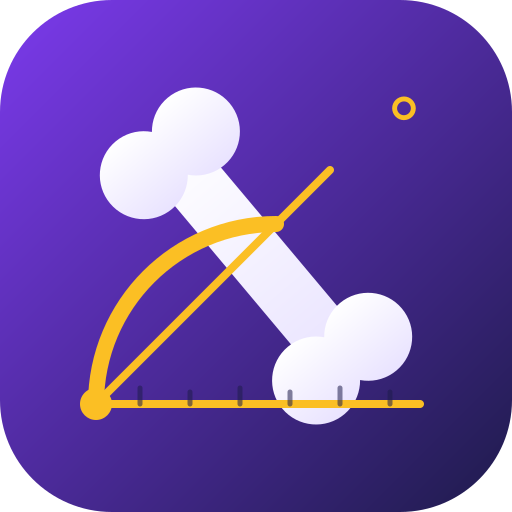

# La Boîte à Outils MSK

Toutes les **mesures ostéo-articulaires** regroupées par articulation — radio, TDM, IRM, écho, arthro, **EOS** — et le **suivi des prothèses**, d'après le *Cotten (Imagerie musculosquelettique)*.

- 402 fiches : technique de tracé, valeurs normales, seuils pathologiques, pièges, source (chapitre/page du Cotten).
- Filtres : articulation, modalité, enfant · onglets Mesures / Prothèses / EOS / Favoris · recherche insensible aux accents.
- « Copier pour le CR », lien direct `#id`, favoris, PWA hors-ligne, pull-to-refresh.

Les fiches marquées *complément* / *hors Cotten* contiennent des valeurs de la littérature à vérifier.

## Mettre à jour les données
1. Modifier/ajouter des fiches dans `data/raw/*.json` (schéma : `data/SCHEMA.md`).
2. `python3 scripts/build_data.py` → régénère `data/measures.json` et `data/embedded_data.js`.
3. Incrémenter `?v=` dans `index.html` et `CACHE` dans `sw.js`, puis commit + push.
